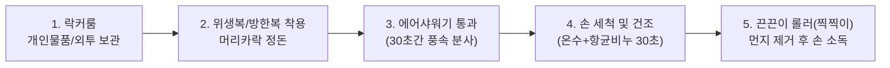

# Chapter 2. 개인 위생 및 작업 복장 규정 (Personal Hygiene & Dress Code)

식품을 취급하는 물류센터는 식품위생법 및 HACCP 기준에 부합하는 엄격한 개인 위생과 복장 기준을 준수해야 합니다.

---

## 1. 현장 입실 전 위생 5단계 수칙

작업장에 입장하기 전 모든 작업자는 예외 없이 아래 5단계를 거쳐야 합니다.

---

## 2. 구역별 복장 기준
| 구역 구분 | 보관 온도 | 필수 착용 복장 및 보호구 |
| :--- | :--- | :--- |
| **상온(Ambient)** | 15°C ~ 25°C | 활동성 유니폼, 코팅 안전장갑, 안전화(스틸 토캡 내장), 위생모/작업모 |
| **냉장(Chilled)** | 0°C ~ 10°C | 기모 보온 내의, 냉장용 방한 자켓, 그립형 방한장갑, 미끄럼 방지 안전화 |
| **냉동(Frozen)** | -18°C 이하 | 특수 냉동용 일체형 방한복, 방한모(발라클라바 또는 넥워머 포함), 3중 보온 방한장갑, 냉동 전용 안전방한화 |

> [!WARNING]
> **귀금속 및 액세서리 착용 전면 금지**  
> 귀걸이, 반지, 목걸이, 피어싱 등은 작업 중 파손되어 식품 내로 혼입(이물 사고)되거나, 냉동실에서 피부와 금속 접촉 시 급성 동상을 유발하므로 착용이 엄격히 금지됩니다.

---

## 3. 손 씻기 및 소독 기준 (30초 룰)
- **손 씻는 시점:**
  - 작업장 입장 전
  - 화장실 이용 직후
  - 흡연 및 휴식 후 현장 복귀 시
  - 오염된 파손품 또는 쓰레기를 취급한 후
- **올바른 손 세척법:** 미온수로 적신 후 거품 비누로 손바닥, 손등, 손가락 사이, 엄지손가락, 손톱 밑, 손목까지 30초 이상 문지르고 종이타월 건조 후 알코올 소독.

---

## 4. 현장 반입 금지 물품
1. **취식물:** 사탕, 껌, 젤리, 초콜릿, 탄산/당류 음료 (생수 라벨이 제거된 투명 텀블러만 지정 장소 음용 허용)
2. **개인 기기 및 위험물:** 스마트폰(업무 승인된 무전/PDA 외 원칙적 보관함 거치), 커터칼날 쪼개기(반드시 일체형 안전칼 사용), 라이터
3. **분실 위험 필기구:** 뚜껑이 분리되는 일반 볼펜 (클립 일체형 볼펜만 휴대 가능)

---
[⬅ Chapter 01. 환영 및 센터 개요](file:///c:/Users/권혁주/Desktop/AI%20교육/anti_git/Chapter_01_환영_및_센터_개요.md) | [다음: Chapter 03. 구역 관리 및 콜드체인 ➡](file:///c:/Users/권혁주/Desktop/AI%20교육/anti_git/Chapter_03_구역관리_및_콜드체인.md)
