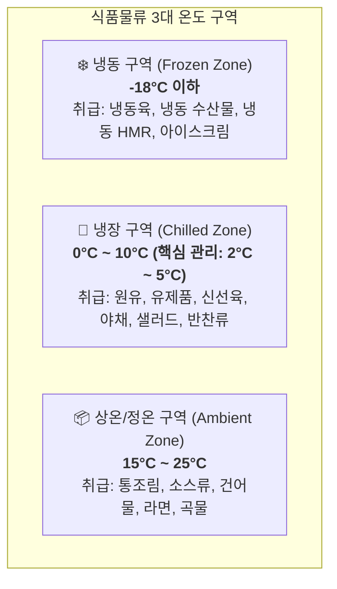

# Chapter 3. 온도대별 구역 관리 및 콜드체인 원칙 (Cold Chain & Temperature Control)

> **작성일자:** 2026-10-28  
> 식품의 부패를 방지하고 최상의 품질을 유지하는 생명선은 산지·공장에서부터 고객 식탁까지 이어지는 **'콜드체인(Cold Chain)'**의 단절 없는 유지입니다.

---

## 1. 온도대별 구역 정의 및 취급 품목



---

## 2. 콜드체인 유지를 위한 현장 골든룰 (Golden Rules)

1. **노출 시간 엄수 (Rapid Transfer):**
   - 납품 차량 도크(Dock) 접안 후 저온 창고 적치까지: **최대 20분 이내**
   - 상온 피킹장/분류장에 화물이 노출되는 시간: **최대 15분 이내**
2. **도크 에어쉘터(Air Shelter) 완벽 밀착:**
   - 화물 트럭 후미와 도크 패드가 틈새 없이 결착되었는지 확인 후 도크 도어를 개방합니다. (외부 열기 및 해충 유입 방지)
3. **냉기 순환 통로(Air Circulation) 확보:**
   - 파렛트와 벽면 간격: 최소 **20cm 이상** 이격 유지
   - 천장 쿨러 유니트(Cooling Unit) 직하부: 바람 통로를 막지 않도록 적재 높이 제한선(Safety Height Line) 준수
4. **창고 방열문 관리:**
   - 사람이나 장비가 통과한 직후 방열문(도어)은 즉시 닫아야 합니다.
   - 문을 열어두고 통로에 화물을 방치하는 행위는 엄격히 금지됩니다.

---

## 3. 온습도 이상 발생 시 비상 대응 SOP
```
[센서 경보/온도 이상 감지]
       ↓
[1차 현장 확인: 방열문 열림 상태, 쿨러 성에(Defrost) 및 결빙 확인]
       ↓
[시설팀 및 현장 관리자 긴급 무전 통보 (±3°C 초과 시 즉각)]
       ↓
[온도 일탈 구역 화물 임시 저온 챔버로 비상 이송]
       ↓
[품질관리(QA)팀 검수 후 '적격/격리' 스티커 부착]
```

---
[⬅ Chapter 02. 개인 위생 및 작업 복장](file:///c:/Users/권혁주/Desktop/AI%20교육/anti_git/Chapter_02_개인위생_및_작업복장.md) | [다음: Chapter 04. 입출고 프로세스 및 선입선출 ➡](file:///c:/Users/권혁주/Desktop/AI%20교육/anti_git/Chapter_04_입출고프로세스_및_선입선출.md)
