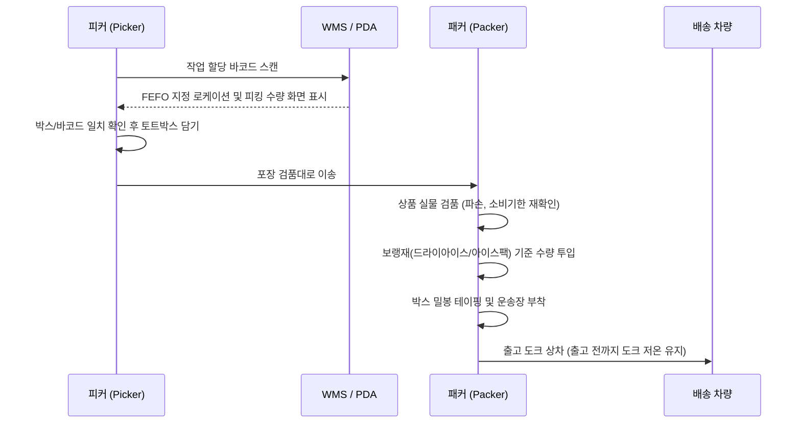

# Chapter 4. 핵심 입출고 프로세스 & 선입선출 (Inbound, Outbound & FIFO/FEFO)

식품 물류센터는 일반 물류와 달리 **유통기한 및 소비기한(Expiration Date)** 관리가 운영의 성패를 가릅니다.

---

## 1. 입고 검수 및 적치 흐름 (Inbound Process)

1. **차량 도착 및 타코메타(온도기록지) 점검:** 납품 트럭 적재함의 운행 중 온도 그래프가 허용치 내였는지 확인 후 인수증 날인.
2. **외관 및 품질 관능 검사:**
   - 포장 파손, 젖음, 박스 눌림 여부
   - 결빙 풀림 흔적(냉동식품 표면의 두꺼운 성에나 육즙 유출 흔적) 점검
   - 탐침 온도계 또는 비접촉 적외선 온도계로 상품 중심온도 측정 후 WMS 입력
3. **바코드 스캔 및 로케이션 적치:** 지정된 빈(Bin) 로케이션 바코드를 먼저 찍고 상품 파렛트를 안착합니다.

---

## 2. 선입선출(FIFO) vs 유통기한 우선(FEFO)

식품 물류에서는 단순 입고순서보다 **소비기한 잔여기간**이 우선합니다.

> [!IMPORTANT]
> **FEFO(First Expired, First Out) 원칙 준수**  
> 늦게 입고된 상품이더라도 소비기한이 더 짧다면 반드시 먼저 출고해야 합니다.

```
[로케이션 적재 기준]
- 앞열 (Front) : 소비기한이 짧은 상품 (피킹 작업자 우선 취급)
- 뒷열 (Back)  : 신규 입고된 소비기한 여유 상품
```

### 소비기한별 출고 제한 임계치 (기준표)
| 품목 유형 | 기준 소비기한 | 출고 제한 기준 (센터 기준) |
| :--- | :--- | :--- |
| **초신선 식품** (샐러드, 샌드위치, 즉석섭취식품) | 2 ~ 4일 | 잔여 유효일수 1.5일 이하 출고 금지 |
| **유제품 및 신선육** (우유, 생닭, 소고기) | 7 ~ 14일 | 잔여 유효일수 3일 이하 출고 금지 |
| **일반 냉장/가공식품** (어묵, 햄, 치즈) | 30 ~ 60일 | 총 유효기간의 30% 미만 출고 금지 |
| **냉동식품** (냉동만두, 너겟 등) | 6개월 ~ 1년 | 총 유효기간의 20% 미만 출고 금지 |

---

## 3. 피킹 및 출고 패킹 프로세스 (Outbound Process)



---
[⬅ Chapter 03. 구역 관리 및 콜드체인](file:///c:/Users/권혁주/Desktop/AI%20교육/anti_git/Chapter_03_구역관리_및_콜드체인.md) | [다음: Chapter 05. 파손 방지 및 교차오염 관리 ➡](file:///c:/Users/권혁주/Desktop/AI%20교육/anti_git/Chapter_05_파손방지_및_교차오염관리.md)
