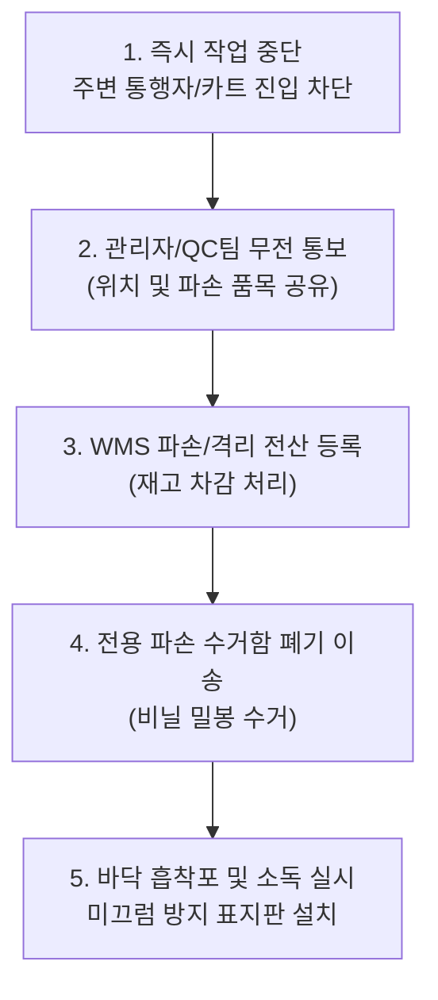

# Chapter 5. 파손·교차오염 방지 및 품질 관리 (Quality Control & Cross-Contamination)

식품 안전사고의 대부분은 부주의로 인한 '외포장 파손 방치'와 '이종 식품 간의 교차오염'에서 비롯됩니다.

---

## 1. 교차오염(Cross-Contamination) 방지 3대 수칙

### ① 상·하단 적재 분리 원칙
원육이나 생선에서 유출될 수 있는 핏물, 즙액, 흙먼지가 아래 상품으로 떨어지는 것을 방지하기 위해 엄격한 단 구분이 적용됩니다.
- **상단 (Upper Level):** 완포장 가공식품, 즉석섭취식품(HMR), 빵류, 씻은 채소/과일
- **중단 (Middle Level):** 포장된 가공육류, 유제품, 계란류
- **하단 (Lower Level):** 원육(소/돼지/닭), 생물 수산물, 흙 묻은 뿌리채소(감자, 무 등)

### ② 알레르기 유발물질(Allergen) 관리
- 우유, 땅콩, 대두, 밀, 갑각류(새우/게), 복숭아, 아황산염 함유 제품 파손 시, 분말이나 액체가 인근 일반 상품에 묻지 않도록 즉시 별도 밀폐용기에 회수합니다.

### ③ 비식품(화학용품/세제류) 격리
- 주방세제, 세탁세제, 락스 등 화학물질은 식품 보관 구역과 물리적으로 격리된 전용 랙에만 보관합니다. 절대 동일 파렛트에 혼적할 수 없습니다.

---

## 2. 파손품(Damaged Goods) 발견 시 긴급 조치 5단계

작업 도중 파손된 상품을 발견했을 때는 임의로 치우거나 방치하지 않고 절차대로 조치합니다.

> [!CAUTION]
> 파손되어 바닥에 흐른 식용유, 우유, 계란 액체류를 방치하면 **지게차 미끄러짐 전복 사고** 및 **보행자 낙상 사고**의 1차 원인이 됩니다. 안전 표지판을 세운 후 즉각 청소 및 탈지 소독을 완료해야 합니다.

---
[⬅ Chapter 04. 입출고 프로세스 및 선입선출](file:///c:/Users/권혁주/Desktop/AI%20교육/anti_git/Chapter_04_입출고프로세스_및_선입선출.md) | [다음: Chapter 06. 현장 안전 및 장비 운용 ➡](file:///c:/Users/권혁주/Desktop/AI%20교육/anti_git/Chapter_06_현장안전_및_장비운용.md)
