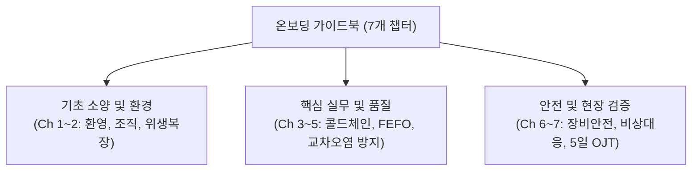

# 📖 식품물류창고 온보딩 가이드북 문서 설명서 (Documentation Guide)

본 문서는 **신선 및 상온 식품물류센터 신규 입사자 교육용 온보딩 가이드북**의 기획 배경, 구성 목적, 활용 방안 및 각 챕터별 핵심 교육 포인트를 설명하는 가이드라인입니다.

---

## 1. 문서 기획 목적 및 배경

식품물류는 일반 공산품 물류와 달리 **온도 관리(Cold Chain), 위생 규정(HACCP), 소비기한 엄수(FEFO)**가 고객의 건강 및 신뢰와 직결됩니다.  
본 온보딩 가이드북은 다음과 같은 목적으로 제작되었습니다:

1. **현장 조기 적응:** 신규 작업자가 첫 주 동안 단계별 OJT를 통해 업무 프로세스를 체계적으로 습득.
2. **안전사고 및 오염 원천 예방:** 냉동실 갇힘·동상, 지게차 충돌, 교차오염 등 고위험 요소를 사전에 숙지.
3. **표준운영절차(SOP) 내재화:** 입출고, 검수, 폐기 처리 등 현장 표준을 명확히 규정하여 작업 오차율 최소화.

---

## 2. 가이드북 구조 및 챕터별 해설

전체 가이드북은 총 7개의 핵심 챕터와 인덱스 문서로 모듈화되어 있습니다.

| 챕터 | 문서명 | 주요 설명 및 핵심 교육 목표 |
| :---: | :--- | :--- |
| **Ch 1** | `Chapter_01_환영_및_센터_개요.md` | 식품물류의 3대 미션(신선도, 신속, 안전)과 입고/재고/출고/QC 부서 간 협업 체계 이해 |
| **Ch 2** | `Chapter_02_개인위생_및_작업복장.md` | 에어샤워 5단계 통과 수칙, 상온/냉장/냉동 복장 규정 및 귀금속/이물질 반입 금지 원칙 |
| **Ch 3** | `Chapter_03_구역관리_및_콜드체인.md` | -18°C 이하/0~10°C/15~25°C 온도대별 관리, 노출 시간 20분 엄수, 에어쉘터 밀착 등 골든룰 |
| **Ch 4** | `Chapter_04_입출고프로세스_및_선입선출.md` | 차량 타코메타 검수, FEFO(소비기한 우선 출고), 피킹 및 보랭재(드라이아이스/팩) 패킹 시퀀스 |
| **Ch 5** | `Chapter_05_파손방지_및_교차오염관리.md` | 상·하단 적재 분리(원육/수산물 하단), 알레르겐 격리, 파손 발생 시 WMS 격리 5단계 조치 |
| **Ch 6** | `Chapter_06_현장안전_및_장비운용.md` | 지게차 서행(10km/h), 냉동실 45/15 작업사이클, 비상 갇힘 방지 버튼(Safety Latch) 조작 |
| **Ch 7** | `Chapter_07_비상상황대응_및_체크리스트.md` | 냉매 누출/정전/화재 대응 SOP, Day 1 ~ Day 5 멘토 동행 OJT 실습 체크리스트 및 최종 서약 |

---

## 3. 현장 교육 및 활용 권장 방안

- **1:1 선임 멘토링 프로그램 연계:** 신규 작업자는 1일 차부터 5일 차까지 담당 멘토와 함께 `Chapter 07` 체크리스트를 점검하며 서명을 진행합니다.
- **현장 비치 및 디지털 단말기 탑재:** 인쇄물 바인더 비치 외에도 작업자용 PDA 및 모바일 인트라넷에 마크다운 뷰어를 연동하여 상시 열람을 지원합니다.
- **정기 업데이트 원칙:** 분기별 현장 안전보건위원회 및 품질관리팀 검토를 통해 변경된 SOP를 지속 반영합니다.
