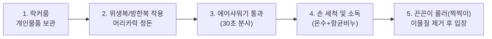
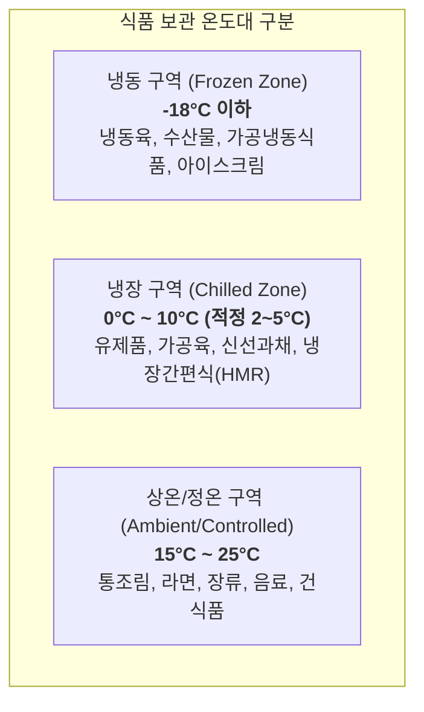
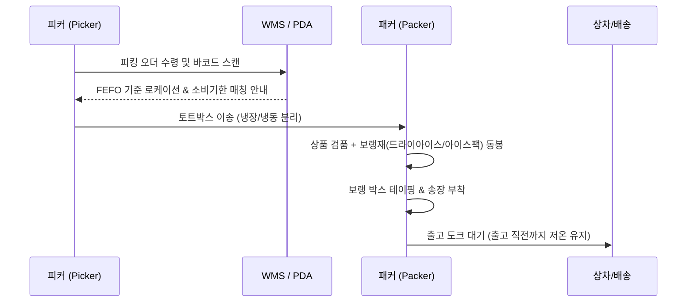
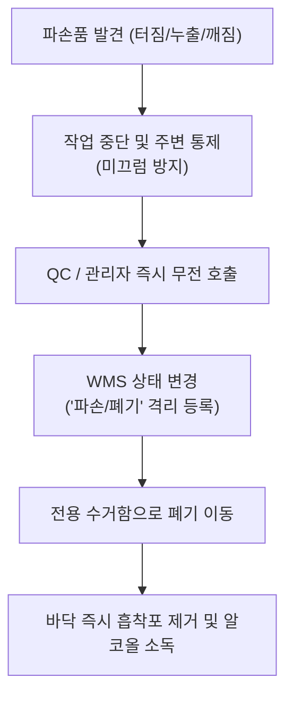

# 🍎 신선·식품물류센터 신규 입사자 온보딩 가이드북
> **"신선함과 안전을 식탁까지 이어주는 식품물류 전문가의 첫걸음"**  
> 본 가이드는 신선 및 상온 식품물류센터에 처음 입사한 직원이 안전하고 정확하게 현장 업무에 적응할 수 있도록 제작된 핵심 업무 매뉴얼입니다.

---

## 📑 목차 (Table of Contents)
1. [Chapter 1. 환영 및 센터 개요 (Welcome & Overview)](#chapter-1-환영-및-센터-개요-welcome--overview)
2. [Chapter 2. 개인 위생 및 작업 복장 규정 (Personal Hygiene & Dress Code)](#chapter-2-개인-위생-및-작업-복장-규정-personal-hygiene--dress-code)
3. [Chapter 3. 온도대별 구역 관리 및 콜드체인 원칙 (Cold Chain & Temperature Control)](#chapter-3-온도대별-구역-관리-및-콜드체인-원칙-cold-chain--temperature-control)
4. [Chapter 4. 핵심 입출고 프로세스 & 선입선출 (Inbound, Outbound & FIFO/FEFO)](#chapter-4-핵심-입출고-프로세스--선입선출-inbound-outbound--fifofefo)
5. [Chapter 5. 파손·교차오염 방지 및 품질 관리 (Quality Control & Cross-Contamination)](#chapter-5-파손교차오염-방지-및-품질-관리-quality-control--cross-contamination)
6. [Chapter 6. 현장 안전 수칙 및 장비 안전 운용 (Warehouse Safety & Equipments)](#chapter-6-현장-안전-수칙-및-장비-안전-운용-warehouse-safety--equipments)
7. [Chapter 7. 비상상황 대응 절차 및 온보딩 체크리스트 (Emergency Response & Onboarding Checklist)](#chapter-7-비상상황-대응-절차-및-온보딩-체크리스트-emergency-response--onboarding-checklist)

---

<br>

# Chapter 1. 환영 및 센터 개요 (Welcome & Overview)

### 1. 환영의 말
식품물류센터의 일원이 되신 것을 진심으로 환영합니다!  
식품물류는 단순한 화물의 이동이 아니라, 소비자의 건강과 직결되는 **'먹거리의 신선도와 안전'**을 책임지는 숭고한 작업입니다. 첫 근무를 시작하기 전 센터의 기본 운영 방향과 조직 체계를 숙지해 주시기 바랍니다.

### 2. 센터 운영 미션
```
[신선도 유지 (Freshness)] ➔ [신속한 출고 (Speed)] ➔ [빈틈없는 위생과 안전 (Safety)]
```
- **고객 신뢰 확보:** 단 1건의 온도 일탈이나 파손품도 최종 고객에게 도달하지 않도록 현장에서 차단합니다.
- **표준 운영 준수(SOP):** 매뉴얼에 명시된 위생 및 안전 기준을 철저히 준수합니다.

### 3. 주요 조직 구성 및 역할
| 부서/팀 | 주요 업무 | 협업 포인트 |
| :--- | :--- | :--- |
| **입고(Inbound)팀** | 하역, 검수/검품, 온도 측정, 입고 적치(Put-away) | 유통기한, 초기 파손 검수, 원산지 라벨 확인 |
| **재고(Inventory)팀** | 구역별 재고 관리, 선입선출 점검, 유효기간 모니터링 | 파렛트 위치 이동, 훼손 상품 격리 |
| **출고(Outbound)팀** | 피킹(Picking), 분류(Sorting), 패킹/포장(Packing), 상차 | 보랭재(아이스팩/드라이아이스) 투입, 오출고 방지 |
| **품질/위생(QC/QA)팀** | 온습도 모니터링, 위생 점검, 반품/폐기 판별 | 이상 발생 시 즉각 보고 및 격리 조치 |
| **안전관리팀** | 작업장 안전 점검, 장비(지게차/핸드자키) 안전 관리 | 안전보호구 착용 및 사고 예방 교육 |

---

<br>

# Chapter 2. 개인 위생 및 작업 복장 규정 (Personal Hygiene & Dress Code)

식품을 취급하는 물류센터는 식품위생법 및 HACCP 기준에 준하는 엄격한 위생 관리가 요구됩니다.

### 1. 입실 전 위생 5단계 수칙


### 2. 구역별 복장 기준
- **상온(Ambient) 구역:** 활동성이 우수한 작업복, 안전화(필수), 위생모/작업모, 장갑(코팅장갑).
- **냉장(Chilled) 구역 (0°C ~ 10°C):** 보온 내의, 냉장용 방한자켓, 미끄럼 방지 안전화, 그립 장갑.
- **냉동(Frozen) 구역 (-18°C 이하):** 
  - 특수 냉동 방한복 상·하의 일체형 착용
  - 방한모(발라클라바 또는 귀마개 포함)
  - 냉동 전용 안전 방한화, 3중 보온 장갑 착용
  - *주의: 금속성 액세서리(반지, 목걸이, 귀걸이)는 동상 및 이물 혼입 위험으로 전면 착용 금지*

### 3. 일상 위생 관리 수칙
- **건강 상태 보고:** 감기, 발열, 설사, 구토, 손 부위의 상처 발생 시 즉시 관리자에게 보고 후 대체 업무 진행.
- **손 씻기 주기:** 화장실 이용 후, 흡연 후, 휴식 시간 종료 후, 파손 상품 처리 후 반드시 비누로 30초 이상 손 세척 후 알코올 소독.
- **현장 반입 금지 물품:** 껌, 사탕, 음료, 담배, 개인 귀중품, 필기구(캡 없는 뚜껑 분리형 볼펜은 클립형만 허용).

---

<br>

# Chapter 3. 온도대별 구역 관리 및 콜드체인 원칙 (Cold Chain & Temperature Control)

식품의 부패를 방지하고 최상의 품질을 유지하는 핵심은 **콜드체인(Cold Chain)**의 단절 없는 연결입니다.



### 1. 콜드체인 골든룰 (Golden Rules)
1. **노출 시간 최소화 (Keep it Fast):** 
   - 도크(Dock) 하역 후 냉장/냉동고 인입 시간: **최대 20분 이내**
   - 상온 피킹장으로 나와 있는 시간: **15분 이내** 준수
2. **냉기 순환 공간 확보:**
   - 벽면과 파렛트 사이 간격: 최소 **20cm 이상** 유지
   - 천장 쿨러(Cooler) 송풍구 바로 밑에는 화물을 적재하지 않음 (냉기 결빙 및 풍도 차단 방지)
3. **도크 에어쉘터(Air Shelter) 밀착 확인:**
   - 차량 접안 시 외부 열기나 빗물, 해충이 유입되지 않도록 쉘터와 차량 적재함의 밀착 상태 확인.
4. **온도 일탈 시 조치:**
   - 쿨러 작동 이상 또는 구역 온도가 ±3°C 이상 30분 지속 상승 시 즉시 시설팀 및 파트장 호출.

---

<br>

# Chapter 4. 핵심 입출고 프로세스 & 선입선출 (Inbound, Outbound & FIFO/FEFO)

식품 물류센터는 일반 공산품 물류와 달리 **소비기한(유통기한)**이 가장 중요한 변수입니다.

### 1. 입고 검수 및 적치 (Inbound Flow)
1. **차량 도착 및 온도 기록지(타코메타) 확인:** 납품 차량의 운행 중 온도 그래프가 기준치 내에 있는지 확인.
2. **샘플링 관능 검사 및 중심온도 측정:** 비접촉식 또는 탐침 온도계로 상품 심부 온도 측정 후 PDA 입력.
3. **외관 검수:** 박스 젖음, 찌그러짐, 결빙 풀림(해동 흔적), 곰팡이 유무 점검.
4. **로케이션 적치:** WMS(창고관리시스템)가 지정한 빈(Bin) 로케이션에 정확히 적치.

### 2. 선입선출(FIFO) 및 유통기한 우선(FEFO) 원칙
> [!IMPORTANT]
> **FEFO(First Expired, First Out) 우선의 원칙**  
> 먼저 입고된 상품이라도 유통기한/소비기한이 더 짧게 남은 상품을 먼저 출고해야 합니다.

- **보관 로케이션 진열:** 기한이 짧은 상품을 앞열(Front), 기한이 넉넉한 신규 입고품을 뒷열(Back)에 적재.
- **소비기한 임계치(출고 불가 기준):**  
  - 일반 냉장식품: 잔여 유효기간 30% 이하 출고 금지
  - 신선 채소/과일: 잔여 일수 2~3일 미만 출고 금지 (품질검사원 별도 검수 필요)

### 3. 출고 및 패킹 프로세스 (Outbound Flow)


---

<br>

# Chapter 5. 파손·교차오염 방지 및 품질 관리 (Quality Control & Cross-Contamination)

식품 안전사고의 대부분은 '파손 방치'와 '이종 상품 간의 교차오염'에서 발생합니다.

### 1. 교차오염(Cross-Contamination) 방지 원칙
- **상하 적재 금지 기준:**
  - `상단`: 가공식품, 완포장 완제품, 신선 과채류
  - `하단`: 원육(소/돼지/닭), 생선 및 수산물, 흙 묻은 구근류(감자/당근)
  - *(원유나 핏물이 하단으로 떨어져 발생할 수 있는 식중독균 오염 원천 차단)*
- **알레르기 유발 물질 분리:** 땅콩, 대두, 갑각류, 메밀 등 알레르기 유발 유제품/견과류 파손 시 즉시 전용 밀폐용기에 수거.
- **비식품(세제, 방향제, 화학물질)의 절대 격리:** 식품 구역과 공산/생활용품 구역은 물리적으로 분리 보관.

### 2. 파손품(Damaged Goods) 발견 시 대처 요령


> [!WARNING]
> 파손되어 흐른 액체를 방치한 채 지게차나 카트가 지나가면 작업장 전체로 오염과 미끄러짐 위험이 확산됩니다. 즉시 청소하고 건조 표지판을 세우십시오.

---

<br>

# Chapter 6. 현장 안전 수칙 및 장비 안전 운용 (Warehouse Safety & Equipments)

식품물류센터는 습기, 바닥 결빙, 좁은 통로, 중장비 운행 등으로 인해 산업재해 위험이 높은 편입니다.

### 1. 지게차 및 물류 장비 안전 수칙
- **속도 제한 준수:** 사내 통로 주행 시 **최고 시속 10km/h 이하** (교차로 및 코너 **5km/h 이하**).
- **시야 확보:** 적재물로 인해 전방 시야가 가려질 경우 반드시 **후진 주행** 또는 유도자 배치.
- **보행자 우선:** 보행자 통로(Yellow Line)를 침범하지 않으며, 교차로에서는 무조건 '일시정지 + 경적 1회'.
- **핸드 파렛트 트럭(핸드자키):**
  - 당기지 말고 미는 방향을 권장 (경사면에서는 절대 화물 아래쪽에 서지 말 것).
  - 작업 완료 후 반드시 포크를 바닥까지 완전히 내리고 통행로 외 지정 자리에 주차.

### 2. 냉동창고 저온 작업자 보호 (동상 & 갇힘 방지)
- **근무/휴식 사이클 엄수:**
  - 냉동실(-18°C 이하) 내부 연속 작업 시간: **최대 45분**
  - 상온 휴게실 휴식 시간: **최소 15분 이상** (따뜻한 온수 섭취)
- **갇힘 방지(Safety Latch) 확인:**
  - 냉동창고 출입문은 정전 시에도 내부에서 열리는 **'비상 탈출 푸시 버튼(Push Rod)'**이 장착되어 있습니다.
  - 입실 전 탈출 장치의 위치와 야광 표식을 반드시 눈으로 확인하십시오.

### 3. 미끄러짐 및 중량물 취급 안전
- 물기나 얼음이 있는 바닥은 발견 즉시 제설/제습 스퀴지로 제거.
- 중량물(15kg 이상)은 허리를 굽히지 않고 무릎을 굽혀 다리 힘으로 들어 올리며, 25kg 이상은 2인 1조 작업 원칙.

---

<br>

# Chapter 7. 비상상황 대응 절차 및 온보딩 체크리스트 (Emergency Response & Onboarding Checklist)

### 1. 긴급 비상상황 대응 절차
| 상황 | 1차 조치 사항 | 비상 연락망 |
| :--- | :--- | :--- |
| **냉매(암모니아/프레온) 누출** | 경보 작동 확인, 즉시 방독면 착용 후 바람 반대 방향으로 옥외 대피 (절대 엘리베이터 금지) | 방재실 (내선 119/112) |
| **정전 / 냉각기 고장** | 모든 냉장·냉동실 도어 즉시 밀폐 폐쇄, 도크 셔터 하강, 품질관리팀 통보 | 시설관리팀 (내선 104) |
| **작업자 부상 / 동상 / 낙상** | 추가 위험 요소 차단, 보온 조치, 구급함 응급처치, 필요 시 119 후송 | 안전보건실 (내선 101) |
| **화재 발생** | "불이야" 외치고 발신기 누름, 초기 소화(소화기 2구 이내), 실패 시 비상구 대피 | 소방안전관리자 (내선 119) |

---

### 2. 신규 입사자 첫 주 온보딩 체크리스트 (Week 1 Checklist)

신규 입사자는 선임 멘토와 함께 아래 항목을 확인하고 확인 서명을 완료해야 합니다.

- [ ] **Day 1: 기본 소양 및 환경 적응**
  - [ ] 사원증 발급 및 출입 권한 등록
  - [ ] 개인 위생 보호구 및 규정 방한복/안전화 지급 수령
  - [ ] 비상 탈출구, 소화기, 비상샤워기, 휴게실 위치 확인
- [ ] **Day 2: 위생/품질 및 콜드체인 기초**
  - [ ] 에어샤워 및 손 세척 5단계 실습 완료
  - [ ] 온도대별 창고 기준 및 쿨러 적재 금지선 교육 이수
  - [ ] 유통기한(FEFO) 확인 및 PDA 기본 조작법 습득
- [ ] **Day 3: 현장 입·출고 실무 OJT**
  - [ ] 멘토 동행 하역 및 입고 검품 실습 (온도 측정기 사용)
  - [ ] 보랭재(드라이아이스/팩) 포장 및 규격 박스 테이핑 실습
  - [ ] 파손품 발생 시 격리 및 WMS 등록 프로세스 실습
- [ ] **Day 4: 물류 장비 및 산업 안전**
  - [ ] 전동 평카트 / 핸드자키 안전 점검 및 조작 실습
  - [ ] 지게차 통행로 안전수칙 및 경적 에티켓 교육
  - [ ] 냉동고 갇힘 방지 푸시 버튼 직접 시연 확인
- [ ] **Day 5: 독립 실무 평가 및 면담**
  - [ ] 단독 피킹/패킹 모의 작업 테스트 (오피킹/오출고 검증)
  - [ ] 파트장 1:1 피드백 면담 및 온보딩 설문지 제출

---
**입사자 서명:** `____________________` &nbsp;&nbsp;&nbsp;&nbsp; **멘토/관리자 확인:** `____________________` &nbsp;&nbsp;&nbsp;&nbsp; **일자:** 202  .   .   .
